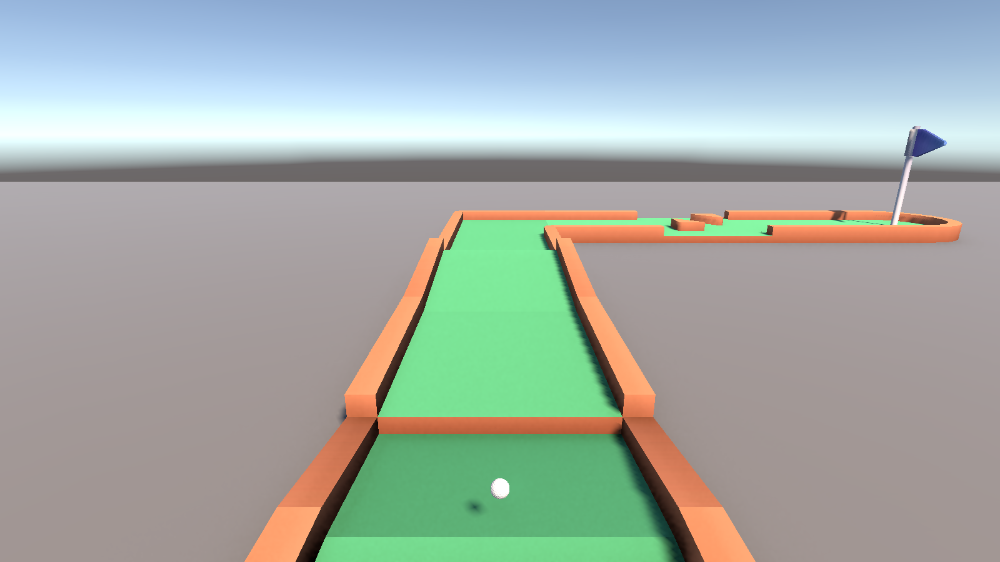
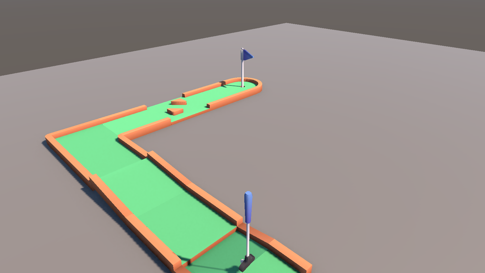
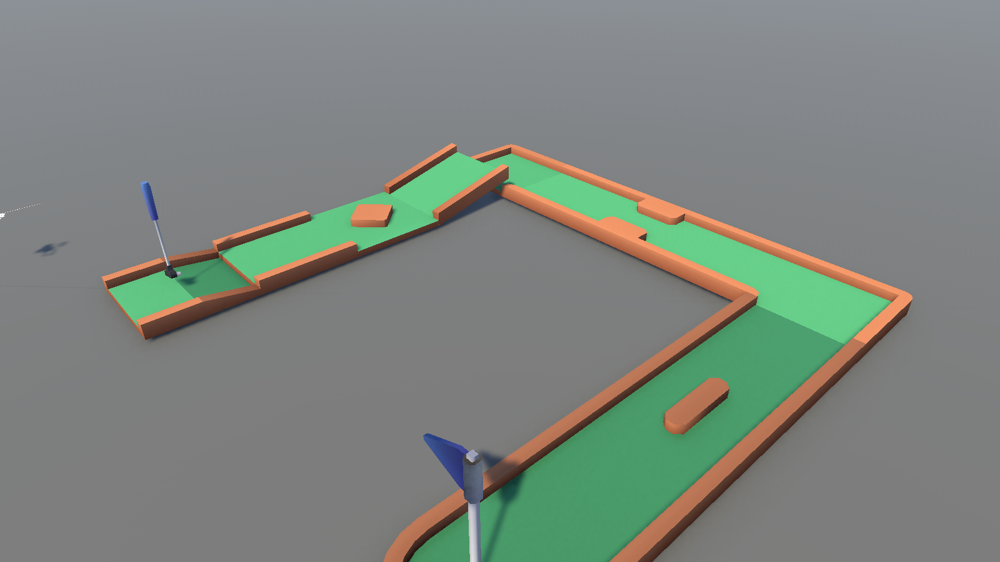
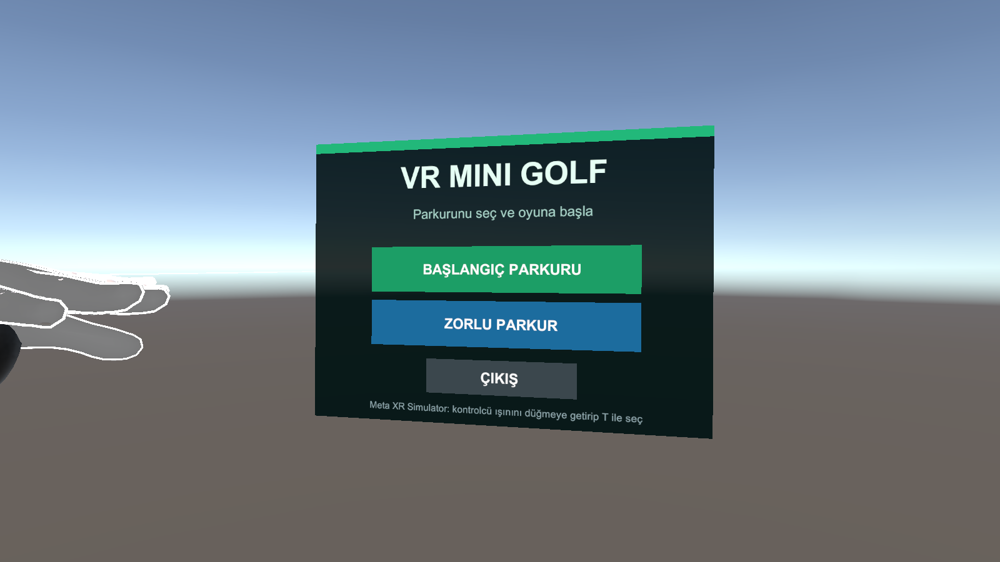
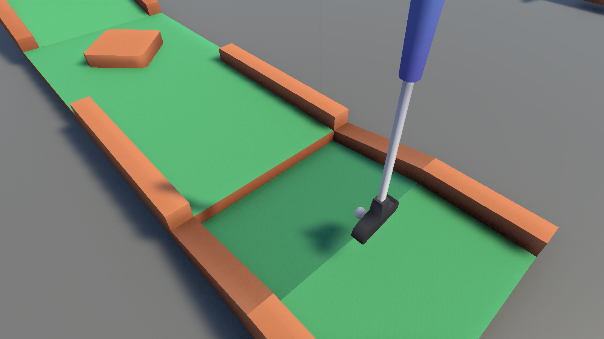

<div align="center">

# ⛳ VR Mini Golf

**A physics-driven mini golf game for Meta Quest — grab the putter, swing for real, sink the ball.**




[English](#about) · [Türkçe](#türkçe)

</div>

---

## About

VR Mini Golf is a two-hole mini golf game built in Unity for Meta Quest. There are no buttons for putting: you pick up the putter with the grip button and swing it with your own arm. The speed and direction of the club head at impact decide where the ball goes.

The game starts in a floating world-space menu. You play the **Beginner Course** and then the **Challenge Course** (ramps, bumps and obstacles), and finish on a scoreboard that totals your strokes across both holes.

## Screenshots

| Beginner course | Challenge course |
| :---: | :---: |
|  |  |
| **Main menu (world-space UI)** | **Lining up a putt** |
|  |  |

## Features

- **Real swing physics.** The putter's head velocity is sampled every frame and smoothed. A box sweep between physics steps means fast swings never pass through the ball. A response curve gives precise control on soft putts.
- **Real-world scale.** The ball is a regulation 42.67 mm / 45.93 g golf ball and the putter is scaled to 0.90 m, so distances feel right in VR.
- **Custom ball behaviour.** Grass rolling friction, speed-dependent wall bounces, slope-aware anti-hop logic (the ball climbs ramps but doesn't bounce off seams), and an automatic respawn to the last valid position when it leaves the course.
- **Haptic feedback** on the hand holding the club, scaled by how hard you hit.
- **VR-friendly UI.** Menus and scoreboards follow your view with a comfort dead zone and are clicked with the Meta controller ray.
- **Session scoring.** Strokes persist across scenes. Final score is `100 − 5 × total strokes`, never below 0. Mini golf rules apply: no new stroke while the ball is still rolling.
- **Loading screen** with real async scene-load progress.
- **Automated PlayMode tests** for ramp physics and scoring. They run headless; XR is switched off for the run.

## Controls

| Action | Meta Quest controller | Meta XR Simulator |
| --- | --- | --- |
| Grab / hold the putter | Grip | `U` |
| Putt | Swing the putter through the ball | — |
| Press a menu button | Point the ray + Trigger | `T` |

## How it works

| Script | Responsibility |
| --- | --- |
| [`VRGolfClub`](Assets/Scripts/VRGolfClub.cs) | Grab handling (Meta Interaction SDK), swing sampling, swept hit detection, haptics |
| [`BallController`](Assets/Scripts/BallController.cs) | Rolling friction, wall bounces, slope handling, checkpoints & respawn |
| [`GolfHole`](Assets/Scripts/GolfHole.cs) | Sinking the ball, pausing play, showing results, loading the next course |
| [`GameManager`](Assets/Scripts/GameManager.cs) · [`MiniGolfSession`](Assets/Scripts/MiniGolfSession.cs) | Persistent stroke counting and scoring across scenes |
| [`MiniGolfMainMenu`](Assets/Scripts/MiniGolfMainMenu.cs) · [`MetaLevelTransitionUI`](Assets/Scripts/MetaLevelTransitionUI.cs) | World-space VR menus, loading screen and scoreboard |
| [`MiniGolfSceneCatalog`](Assets/Scripts/MiniGolfSceneCatalog.cs) | Course order from Build Settings, menu excluded from hole numbering |

## Getting started

**Requirements:** Unity **6000.4.4f1** (Android Build Support), Git LFS, and a Meta Quest headset or the Meta XR Simulator.

```bash
git lfs install
git clone https://github.com/Spark065/XR-deneme-2026-08-07_14-33-03.git
```

1. Open the folder in Unity Hub.
2. Open `Assets/Scenes/MainMenu.unity` and press **Play**. Use Quest Link or the Meta XR Simulator.
3. To build for the headset, switch the platform to **Android** (a *Meta Quest* build profile is included), connect the Quest and choose **Build And Run**.

**Running the tests:** *Window → General → Test Runner → PlayMode → Run All*.

## Built with

- Unity 6 · Universal Render Pipeline 17
- Meta XR SDK 205 (Interaction SDK, Building Blocks) · OpenXR · XR Interaction Toolkit
- Unity Input System · uGUI · Unity Test Framework
- Course pieces, flags and putter: [Kenney Minigolf Kit](https://kenney.nl/assets/minigolf-kit) (CC0)

---

## Türkçe

**VR Mini Golf**, Meta Quest için Unity ile geliştirilmiş, fizik tabanlı iki delikli bir mini golf oyunudur. Vuruş için tuş yok: Grip tuşuyla sopayı tutuyor ve kendi kolunla sallıyorsun. Topun gideceği yeri, çarpma anındaki sopa başının hızı ve yönü belirliyor.

- **Gerçekçi vuruş:** Sopa başının hızı her karede ölçülüyor. Hızlı salınımlarda topun içinden geçilmemesi için fizik adımları arasında kutu taraması (sweep) yapılıyor.
- **Gerçek ölçüler:** Top 42.67 mm / 45.93 g, sopa 0.90 m.
- **Top fiziği:** Çim sürtünmesi, hıza bağlı duvar sekmesi ve rampaya çıkabilen ama zıplamayan top. Parkurdan çıkınca son geçerli noktaya geri dönüyor.
- **Titreşim (haptic)** vuruş gücüne göre ayarlanıyor.
- **VR arayüzü:** Bakışı takip eden menüler, kontrolcü ışınıyla tıklanıyor.
- **Skor:** İki deliğin toplam vuruşuna göre `100 − 5 × vuruş` (en az 0).
- **Otomatik testler:** Rampa fiziği ve skor hesabı için PlayMode testleri.

**Kontroller:** Sopayı tutmak için Grip (simülatörde `U`), menü düğmeleri için ışın + Trigger (simülatörde `T`).

**Çalıştırma:** Unity 6000.4.4f1 ile projeyi aç, `Assets/Scenes/MainMenu.unity` sahnesini başlat. Quest için platformu Android yapıp **Build And Run** seç.

---

<div align="center">

Developed by **[Spark065](https://github.com/Spark065)**

</div>
